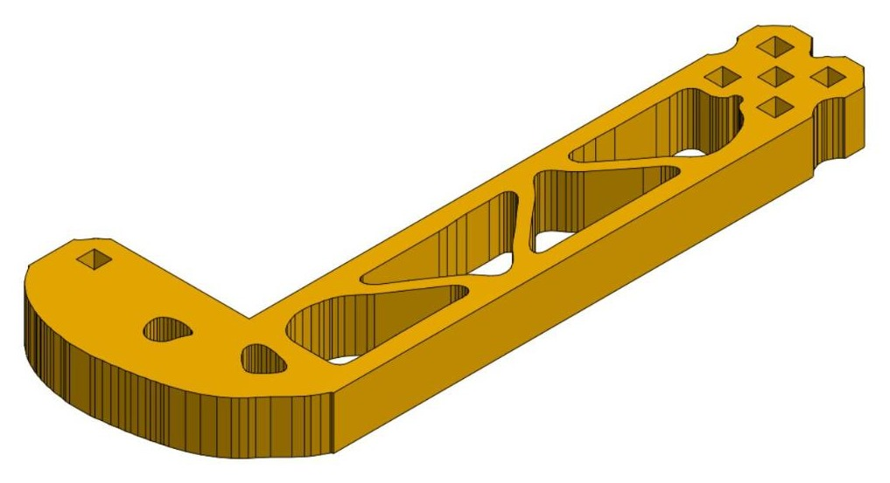
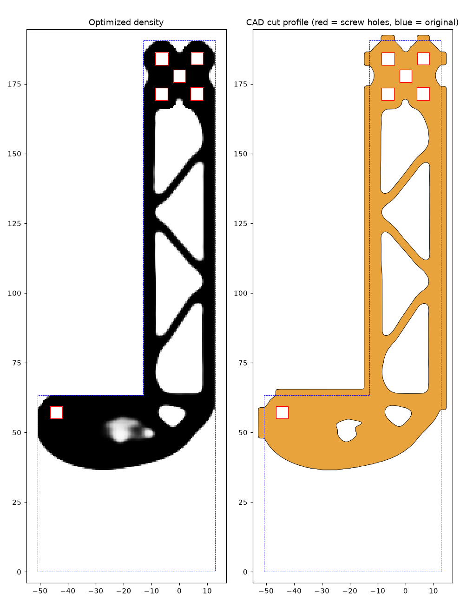

# Onshape Topology Optimizer

Topology optimization for flat robot plates designed in Onshape. Point it at a Part Studio, choose which screw holes are bolted down and which ones carry the load, and it cuts the plate down to a light, stiff truss. The result is written back into Onshape as ordinary sketch and extrude features, so the part stays editable.



## Case study: VEX intake side plate

I designed my intake side as two ½" (12.7 mm) plates in Onshape, with six square screw holes: one on the side block and a group of five at the far end of the arm. I merged the two parts into one and optimized it to keep 40% of the material, treating it as a bracket that connects the single hole to the five-hole group and must stay stiff when pushed or twisted in any direction within the plate.

| | Before | After |
| --- | --- | --- |
| Parts | 2 | 1 (merged) |
| Volume | 91,289 mm³ | 37,057 mm³ (**40.6%**) |
| Stiffness vs. the solid plate | 100% | 80% lengthwise, 63% sideways, 70% in twist |
| Thinnest member | | 2.7 mm |
| Narrowest pocket | | 3.4 mm (fits a ⅛" end mill) |
| Wall around every screw hole | | at least 2.9 mm |

The optimizer turned the arm into a three-diagonal truss and the side block into a curved gusset, and removed the corner of the plate that carried no load.



Details and the exact command are in [examples/intake-side](examples/intake-side).

## How it works

1. **Read the plate.** The tool downloads the parts' face triangles through the Onshape REST API, checks that they form one flat plate of constant thickness, and maps it onto a grid (0.5 mm squares by default).
2. **Protect the screw holes.** Every hole is found automatically and keeps a solid ring of material (3 mm by default).
3. **Optimize.** A SIMP finite-element optimization (plane-stress quad elements, density filter with Heaviside projection, optimality-criteria updates) decides where material is needed. The fixed holes are held still and the load holes are pulled along both in-plane axes and twisted. Each load case counts equally, so the part ends up stiff in every in-plane direction. The filter radius sets the minimum member width.
4. **Make it buildable.** The density field becomes one outline plus a set of pockets. Edges are smoothed, tiny pockets are dropped, and the tool reports the thinnest member, the narrowest pocket and the wall around each hole.
5. **Write it to Onshape** (`--apply`). The tool adds a Boolean union of the selected parts, an outline sketch with an *Extrude → Intersect*, then a pocket sketch with an *Extrude → Remove*. After every step it checks the sketch regions, their area and the part volume against the prediction, and at the end it checks that every screw hole is still open. If anything does not match, it deletes the features it added and stops.

## Install

Requires Python 3.10 or newer.

```bash
pip install git+https://github.com/zhonibek/onshape-topology-optimization
```

## Use

**1. Create an Onshape API key** at [dev-portal.onshape.com/keys](https://dev-portal.onshape.com/keys) with read and write access, then set it in your shell:

```bash
export ONSHAPE_ACCESS_KEY=...
export ONSHAPE_SECRET_KEY=...
```

(PowerShell: `$env:ONSHAPE_ACCESS_KEY = "..."`)

**2. List the holes.** Copy the Part Studio URL from your browser:

```bash
onshape-topopt holes "https://cad.onshape.com/documents/<did>/w/<wid>/e/<eid>"
```

This prints every hole with its position and saves `topopt-output/holes.png` with the labels H1, H2, …

**3. Do a dry run** with the holes you want held and loaded:

```bash
onshape-topopt run "https://cad.onshape.com/documents/<did>/w/<wid>/e/<eid>" --fixed H1 --load rest --volfrac 0.4
```

Check `topopt-output/preview.png` and the numbers it prints. Nothing is written to Onshape yet.

**4. Apply it** by running the same command with `--apply`. The new features are named `TopOpt - …` and sit at the end of the feature list. Suppress or delete them to get the original part back.

You can try the whole pipeline without an Onshape account on the saved intake-side geometry:

```bash
onshape-topopt run --tessellation examples/intake-side/tessellation.json --fixed H1 --load rest
```

### Options

| Option | Default | What it does |
| --- | --- | --- |
| `--parts` | every solid part | Comma-separated part names to merge and optimize |
| `--fixed` | (required) | Holes held still, for example `H1` or `1,2` |
| `--load` | `rest` | Holes where force comes in, for example `H2-H6` |
| `--volfrac` | `0.40` | Share of the material to keep |
| `--filter` | `4.5` | Filter radius in mm; bigger gives thicker, fewer members |
| `--ring` | `3.0` | Solid wall kept around every hole, in mm |
| `--load-cases` | `x,y,twist` | Which in-plane load cases to include |
| `--element` | `0.5` | Grid size in mm; smaller is finer but slower |
| `--min-pocket` | `8` | Pockets smaller than this many mm² are left solid |
| `--apply` | off | Write the features into the Part Studio |

A 0.5 mm grid on a 190 mm plate takes about 3 to 4 minutes on a laptop CPU.

## Limitations

- Only flat plates of constant thickness that lie parallel to the Top, Front or Right plane. Every cut goes straight through the plate.
- Only in-plane loads. Out-of-plane bending, buckling and material strength are not checked, so verify critical parts with your own FEA or testing.
- Loads are unit loads. The shape depends on where force enters and in which directions, not on its size.
- The feature recipe is the one used to build the intake side above. If Onshape rejects or changes a step, the tool removes what it added and stops.

## Tests

```bash
pip install -e ".[test]"
pytest
```

The tests cover plate detection (including tilted plates and rejected slopes or steps), hole finding on the real intake-side geometry, the optimizer, the cut profile and the Onshape feature JSON.

## License

MIT. See [LICENSE](LICENSE).
