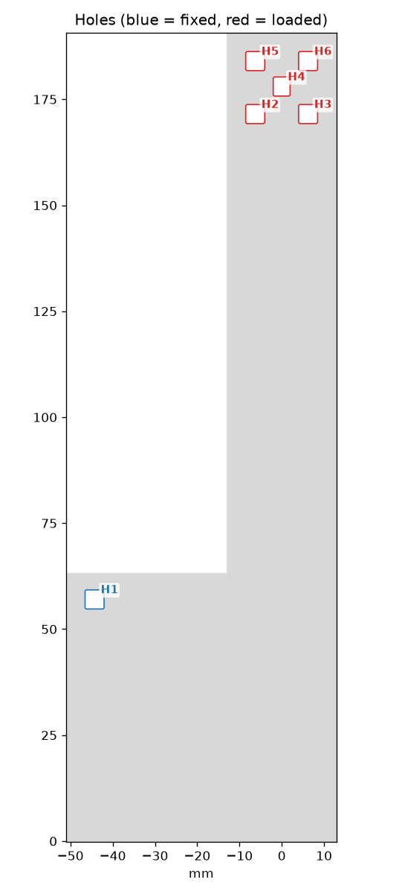
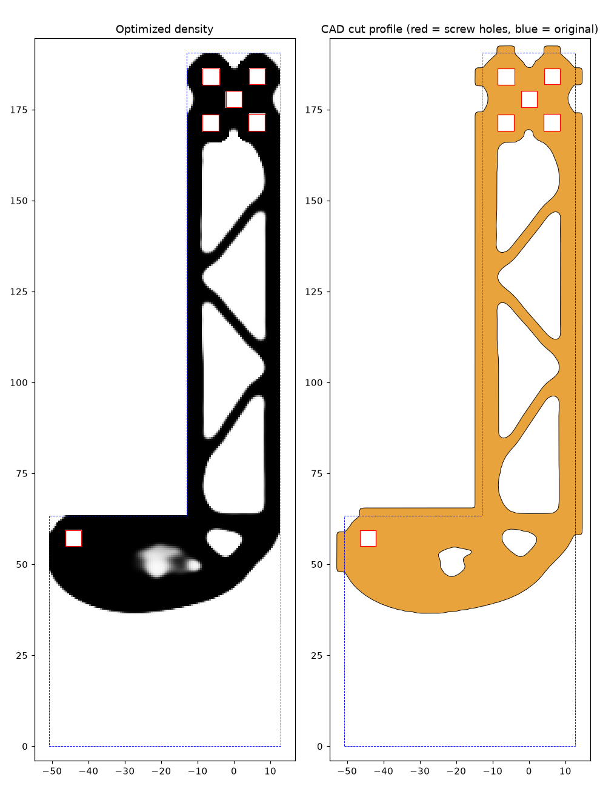
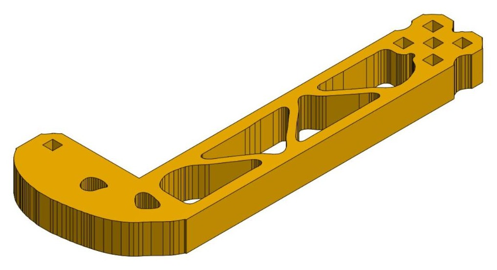

# VEX intake side plate

The intake side started as two ½" (12.7 mm) plates in one Onshape Part Studio: a 25.8 × 190.5 mm arm (Part 1) and a 37.9 × 63.4 mm side block (Part 2). Together they form an L. All six square holes take screws: one on the side block (H1) and a group of five at the far end of the arm (H2 to H6).



## Set-up

- **Merge:** Part 1 and Part 2 joined with a Boolean union.
- **Held:** H1. **Loaded:** H2 to H6, which share every load equally.
- **Load cases:** pull along the arm, push across it, and twist, each counted equally. Since the plate only connects two screw groups, the design is the same whichever group is the one bolted down.
- **Material budget:** 40%.
- **Grid:** 0.5 mm. **Filter radius:** 4.5 mm (thicker members than the 2 mm I tried first, which gave 1.5 mm struts). **Ring around each hole:** 3 mm.

```bash
onshape-topopt run --tessellation examples/intake-side/tessellation.json --fixed H1 --load rest
```

## Result



The arm became a truss with three diagonals between two side rails, the five-hole group sits on a solid pad, and the side block became a curved gusset with two lightening pockets. The unloaded bottom corner of the plate was removed.

Measured on the finished part in Onshape:

| | Value |
| --- | --- |
| Volume | 91,289 mm³ → 37,057 mm³ (40.6%) |
| Stiffness vs. the solid plate | 80% lengthwise, 63% sideways, 70% in twist |
| Thinnest member | 2.7 mm |
| Narrowest pocket | 3.4 mm |
| Wall around every screw hole | at least 2.9 mm |



Running the command above with the packaged tool gives the same layout: 40.4% material, stiffness 81% lengthwise, 64% sideways and 70% in twist, thinnest member 2.71 mm. It runs in about 3.5 minutes on a laptop CPU. In that run the low-stress area in the gusset splits into two small pockets instead of one.

## Files

- `tessellation.json`: the original parts' top faces exactly as Onshape tessellates them. The bottom faces are copies 12.7 mm lower, and side faces are left out because the tool does not need them.
- `holes.png`, `optimization-preview.png`, `onshape-result.jpg`: the pictures above.
